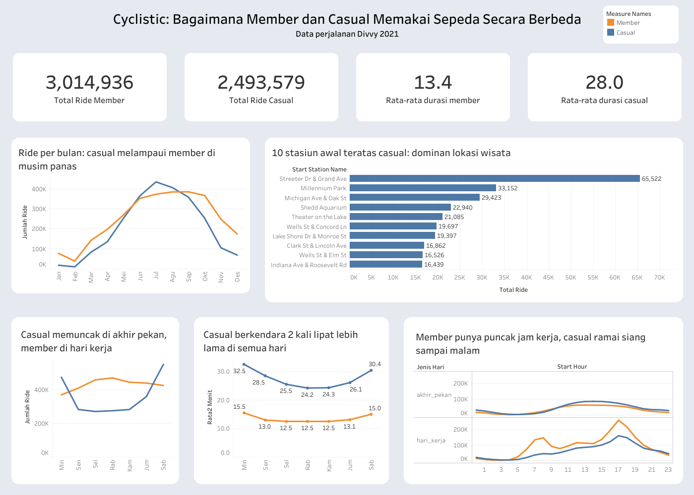

## cyclistic-bike-share-analysis
Studi kasus Google Data Analytics Capstone. Analisis 5,5 juta data perjalanan sepeda di Chicago (tahun 2021) memakai MySQL dan Tableau Public.

## Scenario
You are a junior data analyst working on the marketing analyst team at Cyclistic, a bike-share company in Chicago. The director of marketing believes the company’s future success depends on maximizing the number of annual memberships. Therefore, your team wants to understand how casual riders and annual members use Cyclistic bikes differently. From these insights, your team will design a new marketing strategy to convert casual riders into annual members. But first, Cyclistic executives must approve your recommendations, so they must be backed up with compelling data insights and professional data visualizations.
## Business Task
Cyclistic, perusahaan bike-share di Chicago, ingin mengubah pengguna casual menjadi annual member karena annual member lebih menguntungkan bagi perusahaan. Pertanyaan bisnis yang saya jawab adalah: “Bagaimana annual member dan pengguna casual memakai sepeda Cyclistic secara berbeda?” Untuk menjawabnya, saya menganalisis pola penggunaan berdasarkan jam, hari, dan musim, serta durasi perjalanan dan lokasi awal, agar diketahui kapan dan di mana pengguna casual paling aktif. Analisis ini diminta oleh Lily Moreno, Director of Marketing Cyclistic. Hasilnya akan dipakai tim marketing untuk merancang strategi, dan rekomendasinya akan dipresentasikan kepada tim eksekutif Cyclistic untuk disetujui.
